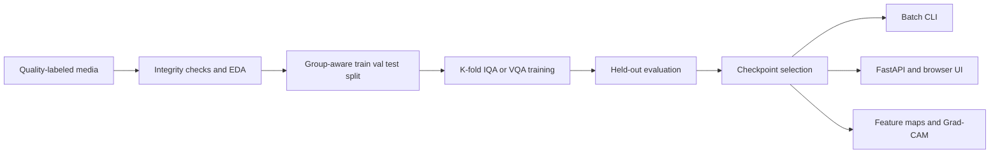

<p align="center">
  
</p>

<p align="center">
  Reproducible IQA/VQA data processing, training, evaluation, response visualisation, and deployment.
</p>

<p align="center">
  <a href="https://www.python.org/"></a>
  <a href="https://pytorch.org/"></a>
  <a href="https://github.com/autentisitet/deep-vqa-framework"></a>
  <a href="https://github.com/autentisitet/deep-vqa-framework/releases"></a>
  <a href="LICENSE"></a>
</p>

<p align="center">
  <strong>English</strong> | <a href="README_zh.md">简体中文</a>
</p>

A single-instance image and video quality assessment service: media validation,
group-aware splits, IQA/VQA training, held-out evaluation with a reproducible
benchmark, and a FastAPI + Nginx deployment with per-person accounts, designed
for one small host rather than a cluster.

It ships two trained checkpoints (TID2013 image IQA, KoNViD-1k video VQA) and
the pipeline that produced them. It is deliberately not a model zoo; see
[Scope](#scope).

Start with `make` to display the project command index. `make help`, `make h`,
and `make ?` are equivalent. `make --help` displays GNU Make's own command-line
options, not the commands defined by this repository.

## Contents

- [Design Decisions](#design-decisions)
- [Benchmark](#benchmark)
- [Workflow](#workflow)
- [Quick Start](#quick-start)
  - [Install](#install)
  - [Prepare Data](#prepare-data)
  - [Train](#train)
  - [Run The Browser Service](#run-the-browser-service)
  - [Batch Inference](#batch-inference)
- [Model Design](#model-design)
- [Interpretation And Data Coverage](#interpretation-and-data-coverage)
- [Repository Layout](#repository-layout)
- [Documentation](#documentation)
- [Development Checks](#development-checks)
- [Scope](#scope)
- [Contributors](#contributors)
- [License And Credits](#license-and-credits)

---

## Design Decisions

Every choice below follows from one constraint: the whole service has to run as a
single instance with both models loaded. Each decision is stated with the
evidence that motivated it.

**Both checkpoints stay resident in one worker process.** Deserialising a
checkpoint per request dominated latency and made the memory ceiling
unpredictable. Measured with both resident: 1617 MiB process RSS, with 0.62 s and
0.73 s one-time load for the image and video models.

**Heavy requests are serialised, and the peak is measured rather than assumed.**
Two concurrent video decodes plus two forward passes do not fit a 4 GB instance,
so the deployment profile serialises heavy work instead of queueing it. Container
memory, host available memory, and swap are measured by
`make docker-memory-measure`; sampled peaks are reported as lower bounds.

**SQLite rather than a server database.** Evaluation history is a single-writer,
append-only log. A database server would spend a large share of the memory budget
without removing any constraint at this scale, so the history file is instead
bounded by configuration.

**Per-instance accounts rather than one shared key.** A single deployment key
would let every visitor read every other visitor's artifacts and history.
Accounts bind artifacts to a person, so signing in from another browser still
reaches your own data. Roles, organisations, and SSO remain out of scope.

**Metrics are reported raw and mapped, never merged.** Raw PLCC understates a
regressor's combined ranking and calibration quality; the five-parameter
logistic mapping is the convention in the IQA literature. Because that mapping
is fitted on the held-out set, it is strictly a reporting transform and is never
used for checkpoint selection.

**Cold and warm latency are reported separately.** The first inference includes
kernel and cache warm-up and is not representative of steady-state cost. Both
figures are in the latency table below; latency varies between runs, so treat the
order of magnitude as the finding rather than the last digit.

Supported serving formats are JPG/PNG/WEBP and MP4/MOV/MKV. File extensions
are used only for routing; OpenCV or Decord must still decode the content.

---

## Benchmark

The published checkpoints were evaluated on the held-out splits recorded by
the training manifests. The run below used CPU inference with PyTorch and
OpenCV pinned to two threads.

| Model | Dataset | N | SROCC | KROCC | Raw PLCC | Mapped PLCC | Raw RMSE | Mapped RMSE |
| :--- | :--- | ---: | ---: | ---: | ---: | ---: | ---: | ---: |
| IQA (`tid2013_best.pt`) | TID2013 | 238 | 0.8700 | 0.6819 | 0.8446 | 0.8775 | 1.1910 | 0.5638 |
| VQA (`konvid-1k_best.pt`) | KoNViD-1k | 119 | 0.7417 | 0.5435 | 0.7409 | 0.7468 | 0.6933 | 0.4104 |

Raw metrics use model outputs directly. Mapped PLCC and RMSE use a monotonic
five-parameter logistic function fitted on the held-out test set. Mapping is
used only for final reporting, never for training or checkpoint selection.

As a check that the models learn something beyond low-level image statistics, the
same harness scores a deterministic `opencv-handcrafted-heuristic` baseline on
the identical samples, using reproducible OpenCV metrics (Laplacian sharpness,
median-residual noise, exposure and clipping, contrast, and temporal stability):

| Model | Dataset | Model SROCC | Baseline SROCC | Delta | Model mapped PLCC | Baseline mapped PLCC | Delta |
| :--- | :--- | ---: | ---: | ---: | ---: | ---: | ---: |
| IQA | TID2013 | 0.8700 | 0.1321 | **+0.7379** | 0.8775 | 0.2097 | **+0.6678** |
| VQA | KoNViD-1k | 0.7417 | 0.4328 | **+0.3089** | 0.7468 | 0.4626 | **+0.2842** |

A trained network beating a hand-crafted heuristic is the expected outcome, so
read these as a sanity check rather than as a contribution. The image-side gap is
large mainly because Laplacian- and noise-based metrics cannot rank TID2013's
distortion types; the video-side gap over a non-trivial baseline (0.4328) is the
more meaningful one. Both columns pass through the same five-parameter mapping,
so the deltas compare like with like.

| Model | First inference | Steady median | p95 | Estimated serial rate | Parameters | Checkpoint |
| :--- | ---: | ---: | ---: | ---: | ---: | ---: |
| IQA | 56.5 ms | 53.7 ms | 55.2 ms | 18.6 items/s | 28.0 M | 321.5 MiB |
| VQA | 997.2 ms | 957.5 ms | 984.6 ms | 1.04 items/s | 37.5 M | 429.9 MiB |

The rate is derived from serial inference time; it is not a concurrent load
test. Re-run the benchmark on the deployment machine before quoting latency.

```bash
make benchmark
make benchmark ROLES=iqa THREADS=4
make benchmark BENCHMARK_ARGS="--warmup-runs 3"
```

Reports are written to `reports/benchmark/<utc>.json` and `.md`.

---

## Workflow



The TID2013 path consumes distorted images and MOS labels without using the
reference image as a model input. The KoNViD-1k path samples video frames,
extracts spatial features, and applies Transformer-based temporal fusion.

---

## Quick Start

Run `make help` (or plain `make`) to list every project target.
`make --help` prints GNU Make's own options rather than this project's targets.

### Install

```bash
make install DEV=1
make info
```

Use `MIRROR=1` when the configured TUNA package mirror is preferred:

```bash
make install DEV=1 MIRROR=1
```

### Prepare Data

```bash
make data
```

Dataset locations and MOS ranges are defined in
`train-config/dataset_config.yaml`. Training configurations live under
`train-config/models/`.

### Train

```bash
# Image quality assessment
uv run python -m src.main --model swin_iqa --dataset tid2013

# Video quality assessment
uv run python -m src.main --model swin_vqa --dataset konvid-1k

# Text-to-video quality assessment. The loader is registered and documented in
# train-config/dataset_config.yaml, but `make data` downloads only TID2013 and
# KoNViD-1k, so the T2VQA-DB files must be supplied separately.
uv run python -m src.main --model swin_vqa --dataset t2vqa-db
```

Successful runs copy the selected checkpoints to:

```text
deploy/iqa-models/{dataset}_best.pt
deploy/vqa-models/{dataset}_best.pt
```

### Run The Browser Service

```bash
make docker-infer
```

Open `http://127.0.0.1:8000/` and create the first account; no shell command is
needed to sign in.

| Mode | Command | Login and saved data |
| :--- | :--- | :--- |
| Internal | `make docker-infer` | Email + password accounts, SQLite history, saved Grad-CAM/feature PNG files scoped per account |
| Local | `make local` | No login; history scoped to an anonymous browser session |
| Proxy | `make docker-infer DEPLOYMENT_MODE=proxy` | Login handled by the process in front; no evaluation history or saved visualization files |
| GPU | `make docker-infer GPU=1` | Enable NVIDIA GPU runtime on a configured host |

The FastAPI host port defaults to `127.0.0.1:8001`; browser traffic enters
through Nginx on port `8000` using the same-origin `/api/v1` path.

Where the service listens decides who can reach it. Internal and local bind
only to `127.0.0.1` (loopback); proxy mode leaves the app on loopback and
expects a process in front to own the reachable IP and authenticate users. See
the [deployment guide](docs/deployment.md) for the full IP/DNS/NAT path.

### Batch Inference

```bash
make docker-batch-test
make docker-batch-test IMAGES=1
make docker-batch-test VIDEOS=1
```

---

## Model Design

| Input | Shape | Spatial model | Temporal model |
| :--- | :--- | :--- | :--- |
| Image | `[B, 3, H, W]` | Configured ImageNet backbone | None |
| Video | `[B, F, 3, H, W]` | Swin-T applied per frame | Position encoding + Transformer encoder + temporal mean |

All image and video frames use RGB conversion, bicubic resize to 232, center
crop to 224, and ImageNet mean/std normalization.

The task loss is:

```text
Total = 0.7 x SmoothL1 + 0.3 x PairwiseLogisticRank
```

SmoothL1 handles MOS regression, while the pairwise term promotes consistent
quality ordering.

---

## Interpretation And Data Coverage

For IQA inputs, the service can generate:

- backbone feature-map grids;
- regression Grad-CAM overlays;
- original-versus-generated comparisons in the browser.

Grad-CAM on a MOS regressor concentrates on the high-frequency, textured regions
that carry most of the variance for a quality score. That makes it a weak
explanatory signal: it shows where the model looks, not why a given score came
out the way it did. Treat it as a sanity check on the backbone rather than as an
explanation of an individual prediction.

Feature-distribution analysis fits PCA on saved training embeddings and then
projects new samples into the same space:

```bash
uv run python -m src.data.eda.feature_distribution build \
  --checkpoint deploy/vqa-models/konvid-1k_best.pt \
  --dataset konvid-1k

uv run python -m src.data.eda.feature_distribution project \
  --distribution-file results/konvid-1k/eda/feature_distribution/train_pca.npz \
  --checkpoint deploy/vqa-models/konvid-1k_best.pt \
  --input path/to/problem.mp4 \
  --output results/konvid-1k/eda/feature_distribution/problem_projection.json
```

---

## Repository Layout

```text
train-config/     training, model, and dataset YAML
src/              data, training, models, metrics, and visualization
deploy/           FastAPI service, batch CLI, and checkpoint loading
deploy-config/    Compose, Nginx, shared basic.yaml, and internal/proxy/local overrides
frontend/         browser UI in native HTML, CSS, and JavaScript
scripts/          host-side entry points: setup, data, benchmark, maintenance
tests/            training, deployment, frontend, and security contracts
docs/             detailed architecture, OpenAPI schema, and logo, deployment, frontend, and memory docs
results/          training outputs and evaluation manifests
reports/          inference, benchmark, memory, visualization outputs, and SQLite state (accounts, history)
```

---

For targeted container cleanup, use `make docker-purge-train` (dev/training
containers and images only) or `make docker-purge-deploy` (Nginx/inference
containers and inference image only). Both preserve host datasets, reports,
checkpoints, accounts, and the upload volume. `make docker-purge-all` also removes
this project's upload volume, containers, images, and network; see the
[deployment guide](docs/deployment.md#destructive-cleanup).

---

## Documentation

- [Documentation index](docs/README.md)
- [Architecture map](docs/architecture.html)
- [Deployment guide](docs/deployment.md)
- [Frontend guide](docs/frontend.md)
- [Model and container memory](docs/performance.md)
- [Generated OpenAPI schema](docs/openapi.json)
- [Security policy](SECURITY.md)
- [Disclaimer](DISCLAIMER.md)
- [Contributing guide](.github/CONTRIBUTING.md)
- [Changelog](CHANGELOG.md)

---

## Development Checks

```bash
make pytest
make check-code
make typecheck
make version-check
```

Container memory can be measured after the service is running:

```bash
make docker-memory-measure
```

The report includes container memory samples, host available memory, and swap
usage. Sampled peaks are explicitly reported as lower bounds.

---

## Scope

This is deliberately a single-instance ML service, not a platform. The omissions
below are consequences of that constraint rather than unfinished work.

- **Accounts, but no roles or SSO.** Internal mode provides email + password
  accounts so history and artifacts belong to a person rather than a browser;
  proxy mode turns off application login and lets the process in front of it
  authenticate.
  There is no email verification and no self-service password recovery; an
  operator can reset a password from the container. Roles, organisations, and
  identity providers are a different project.
- **No distributed job queue.** Inference takes 54 ms for an image and about
  0.95 s for a video, and the deployment profile already serialises heavy work.
  There is no queueing problem to solve at this scale.
- **SQLite, not a database server.** Accounts and evaluation history are
  single-writer; SQLite keeps the memory budget available to the models.

It is also not a research library. Toolkits such as PyIQA cover far more models
and datasets than this project does, and anyone needing that breadth should use
them. What this repository covers is the path from raw quality-labeled media to a
running service, including the parts usually left out: media validation,
leakage-safe splits, one tested metric implementation, and a measured memory
budget.

---

## Contributors

Thanks to everyone who has contributed code to the repository:

<p>
  <a href="https://github.com/autentisitet" title="autentisitet"></a>
  <a href="https://github.com/Zed-23" title="Zed-23"></a>
  <a href="https://github.com/yss0120" title="yss0120"></a>
  <a href="https://github.com/bazhina-5566" title="bazhina-5566"></a>
</p>

The list is based on the repository's GitHub contributor records.

---

## License And Credits

- **Version**: 0.9.6
- **License**: [MIT](LICENSE)
- **Maintainer**: [@autentisitet](https://github.com/autentisitet)

Core references:

- Liu et al., *Swin Transformer*, ICCV 2021.
- He et al., *Deep Residual Learning for Image Recognition*, CVPR 2016.
- Ponomarenko et al., *Image Database TID2013*, 2015.
- Hosu et al., *The Konstanz Natural Video Database*, QoMEX 2017.
