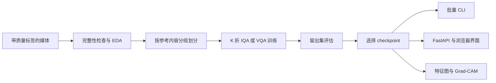

<p align="center">
  
</p>

<p align="center">
可复现的 IQA/VQA 数据处理、训练、评估、响应可视化与部署框架。
</p>

<p align="center">
  <a href="https://www.python.org/"></a>
  <a href="https://pytorch.org/"></a>
  <a href="https://github.com/autentisitet/deep-vqa-framework"></a>
  <a href="https://github.com/autentisitet/deep-vqa-framework/releases"></a>
  <a href="LICENSE"></a>
</p>

<p align="center">
  <a href="README.md">English</a> | <strong>简体中文</strong>
</p>

单实例的图像与视频质量评估服务：媒体校验、按内容分组的数据划分、IQA/VQA 训练、
带可复现基准的留出集评测，以及带独立账号、面向单台小型主机（而非集群）的
FastAPI + Nginx 部署。

它包含两个已训练的 checkpoint（TID2013 图像 IQA、KoNViD-1k 视频 VQA）以及产出
它们的完整流程。它是刻意不做成模型仓库的，详见[项目边界](#项目边界)。

首次使用请执行 `make` 查看项目命令索引。`make help`、`make h` 和 `make ?`
与之等价。注意：`make --help` 显示的是 GNU Make 自身的命令行参数，不是本项目
定义的命令。

## 目录

- [设计取舍](#设计取舍)
- [基准结果](#基准结果)
- [整体流程](#整体流程)
- [快速开始](#快速开始)
  - [安装环境](#安装环境)
  - [准备数据](#准备数据)
  - [训练](#训练)
  - [启动浏览器服务](#启动浏览器服务)
  - [批量推理](#批量推理)
- [模型结构](#模型结构)
- [响应可视化与数据覆盖](#响应可视化与数据覆盖)
- [仓库结构](#仓库结构)
- [文档](#文档)
- [开发检查](#开发检查)
- [项目边界](#项目边界)
- [贡献者](#贡献者)
- [许可证与致谢](#许可证与致谢)

---

## 设计取舍

下面每个选择都源于同一个约束：整个服务必须作为单实例运行，并且两个模型同时
常驻。每条都附上促使该决定成立的证据。

**两个 checkpoint 常驻同一个 worker 进程。** 每个请求都反序列化 checkpoint 既
主导了延迟，也让内存上限变得不可预测。实测两者同时常驻：进程 RSS 1617 MiB，
图像与视频模型的一次性加载分别为 0.62 s 和 0.73 s。

**高开销请求串行执行，并且峰值是实测的而不是假设的。** 两路并发的视频解码加上两次前向
传播装不进 4 GB 实例，因此部署 profile 选择把重任务串行化而不是排队。容器内存、
主机可用内存与 swap 由 `make docker-memory-measure` 测量；采样峰值明确报告为下界。

**用 SQLite 而不是服务端数据库。** 评估历史是单写者、只追加的日志。引入数据库
服务会占掉内存预算中很大一块，却不会在这个规模上解除任何约束，因此历史文件改用
配置直接限制大小。

**用实例内账号而不是一个共享密钥。** 单一部署密钥会让任何访客读到其他访客的
产物与历史。账号把产物绑定到人，因此换一个浏览器登录后仍能访问自己的数据。
角色、组织和 SSO 仍不在范围内。

**指标分成原始值与映射值，且从不合并。** 原始 PLCC 会低估回归模型的排序与标定
综合质量；五参数 logistic 映射是 IQA 文献的通行做法。由于该映射是在留出集上拟合
的，它严格只用于报告，绝不参与 checkpoint 选择。

**冷启动与稳态延迟分开报告。** 首次推理包含内核与缓存预热，不代表稳态开销。两个
数字都在下面的延迟表中；延迟会随运行波动，因此应把数量级当作结论，而不是末位数。

服务端默认支持 JPG/PNG/WEBP 和 MP4/MOV/MKV。文件后缀只用于路由，媒体内容
仍必须通过 OpenCV 或 Decord 解码。

---

## 基准结果

已发布 checkpoint 使用训练 manifest 记录的留出测试集重新推理。下表来自 CPU
推理，并将 PyTorch 和 OpenCV 线程数固定为 2。

| 模型 | 数据集 | N | SROCC | KROCC | 原始 PLCC | 映射后 PLCC | 原始 RMSE | 映射后 RMSE |
| :--- | :--- | ---: | ---: | ---: | ---: | ---: | ---: | ---: |
| IQA (`tid2013_best.pt`) | TID2013 | 238 | 0.8700 | 0.6819 | 0.8446 | 0.8775 | 1.1910 | 0.5638 |
| VQA (`konvid-1k_best.pt`) | KoNViD-1k | 119 | 0.7417 | 0.5435 | 0.7409 | 0.7468 | 0.6933 | 0.4104 |

原始指标直接使用模型输出。映射后 PLCC 和 RMSE 使用在留出测试集上拟合的单调
五参数 logistic 函数。映射只用于最终报告，不参与训练或 checkpoint 选择。

为了确认模型学到的特征确实超出了低层图像统计量，同一套工具还会在**完全相同的
样本**上运行确定性的 `opencv-handcrafted-heuristic` 基线，使用可复现的 OpenCV
指标（Laplacian 清晰度、中值残差噪声、曝光与裁剪、对比度、时序稳定性）：

| 模型 | 数据集 | 模型 SROCC | 基线 SROCC | 差值 | 模型映射后 PLCC | 基线映射后 PLCC | 差值 |
| :--- | :--- | ---: | ---: | ---: | ---: | ---: | ---: |
| IQA | TID2013 | 0.8700 | 0.1321 | **+0.7379** | 0.8775 | 0.2097 | **+0.6678** |
| VQA | KoNViD-1k | 0.7417 | 0.4328 | **+0.3089** | 0.7468 | 0.4626 | **+0.2842** |

训练好的网络战胜手工启发式指标是**预期结果**，因此请把这些数字当作合理性检查，
而不是当作贡献。图像侧差距大，主要是因为基于 Laplacian 和噪声的指标无法对
TID2013 的失真类型排序；视频侧相对一个非平凡基线（0.4328）的差距才更有意义。
两列都经过同一个五参数映射，所以差值是可比的。

| 模型 | 首次推理 | 稳态中位数 | p95 | 串行速率估算 | 参数量 | checkpoint |
| :--- | ---: | ---: | ---: | ---: | ---: | ---: |
| IQA | 56.5 ms | 53.7 ms | 55.2 ms | 18.6 项/秒 | 28.0 M | 321.5 MiB |
| VQA | 997.2 ms | 957.5 ms | 984.6 ms | 1.04 项/秒 | 37.5 M | 429.9 MiB |

串行速率由单次推理时间推导，不是并发压测结果。引用延迟前应在实际部署机器上
重新运行：

```bash
make benchmark
make benchmark ROLES=iqa THREADS=4
make benchmark BENCHMARK_ARGS="--warmup-runs 3"
```

报告保存到 `reports/benchmark/<utc>.json` 和 `.md`。

---

## 整体流程



TID2013 流程只读取失真图像与 MOS，不把参考图像输入模型。KoNViD-1k 流程会
采样视频帧、提取空间特征，并使用 Transformer 完成时序融合。

---

## 快速开始

运行 `make help`（或直接运行 `make`）可列出全部项目命令。
`make --help` 输出的是 GNU Make 自身的选项，不是本项目的命令。

### 安装环境

```bash
make install DEV=1
make info
```

需要使用清华 TUNA 镜像时：

```bash
make install DEV=1 MIRROR=1
```

### 准备数据

```bash
make data
```

数据集路径和 MOS 范围位于 `train-config/dataset_config.yaml`，模型配置位于
`train-config/models/`。

### 训练

```bash
# 图像质量评估
uv run python -m src.main --model swin_iqa --dataset tid2013

# 视频质量评估
uv run python -m src.main --model swin_vqa --dataset konvid-1k

# 文生视频质量评价。loader 已注册并在 train-config/dataset_config.yaml 中记录，
# 但 `make data` 只下载 TID2013 和 KoNViD-1k，T2VQA-DB 需要自行准备。
uv run python -m src.main --model swin_vqa --dataset t2vqa-db
```

训练成功后，选出的 checkpoint 会复制到：

```text
deploy/iqa-models/{dataset}_best.pt
deploy/vqa-models/{dataset}_best.pt
```

### 启动浏览器服务

```bash
make docker-infer
```

打开 `http://127.0.0.1:8000/` 并创建第一个账号，登录不需要在服务器上执行任何命令。

| 模式 | 命令 | 登录与数据保存 |
| :--- | :--- | :--- |
| internal | `make docker-infer` | 邮箱 + 密码账号、SQLite 历史、按账号隔离的 Grad-CAM/特征 PNG |
| local | `make local` | 无登录；历史按匿名浏览器会话隔离 |
| proxy | `make docker-infer DEPLOYMENT_MODE=proxy` | 由前面的进程完成登录；不保存评估历史和可视化文件 |
| GPU | `make docker-infer GPU=1` | 已配置 NVIDIA 驱动和容器运行时的主机可启用 GPU |

FastAPI 的宿主机端口默认绑定到 `127.0.0.1:8001`，浏览器通过 Nginx 的 `8000`
端口的同源 `/api/v1` 路径访问。

服务监听在哪个 IP 上，决定了谁能访问它。internal 与 local 只绑定
`127.0.0.1`（回环）；proxy 模式仍把应用留在回环，由前面的进程持有可访问的 IP
并负责认证。完整链路见[部署指南](docs/deployment.md)（IP/DNS/NAT 说明）。

### 批量推理

```bash
make docker-batch-test
make docker-batch-test IMAGES=1
make docker-batch-test VIDEOS=1
```

---

## 模型结构

| 输入 | 张量形状 | 空间模型 | 时序模型 |
| :--- | :--- | :--- | :--- |
| 图像 | `[B, 3, H, W]` | 配置指定的 ImageNet 主干 | 无 |
| 视频 | `[B, F, 3, H, W]` | 对每帧应用 Swin-T | 位置编码 + Transformer encoder + 时序平均 |

图像与视频帧统一使用 RGB、双三次缩放到 232、中心裁剪到 224，以及 ImageNet
均值和标准差归一化。

损失函数为：

```text
总损失 = 0.7 x SmoothL1 + 0.3 x PairwiseLogisticRank
```

SmoothL1 负责 MOS 回归，成对排序项用于保持质量顺序一致。

---

## 响应可视化与数据覆盖

IQA 输入可以生成：

- 主干网络特征图；
- 回归 Grad-CAM 热力图；
- 浏览器中的原图与生成图对比。

对 MOS 回归模型做 Grad-CAM，热区会集中在贡献质量分数方差最多的高频纹理区域。
这使它成为一个**较弱的解释信号**：它说明模型在看哪里，而不是说明某个分数为什么
是那个值。请把它当作对主干网络的合理性检查，而不是对单次预测的解释。

特征分布分析会在训练集特征上拟合 PCA，并将新样本投影到同一空间：

```bash
uv run python -m src.data.eda.feature_distribution build \
  --checkpoint deploy/vqa-models/konvid-1k_best.pt \
  --dataset konvid-1k

uv run python -m src.data.eda.feature_distribution project \
  --distribution-file results/konvid-1k/eda/feature_distribution/train_pca.npz \
  --checkpoint deploy/vqa-models/konvid-1k_best.pt \
  --input path/to/problem.mp4 \
  --output results/konvid-1k/eda/feature_distribution/problem_projection.json
```

---

## 仓库结构

```text
train-config/     训练、模型和数据集 YAML
src/              数据处理、训练、模型、指标和可视化
deploy/           FastAPI、批量 CLI 和 checkpoint 加载
deploy-config/    Compose、Nginx、共享 basic.yaml 与 internal/proxy/local 模式覆盖
frontend/         原生 HTML、CSS、JavaScript 浏览器界面
scripts/          宿主机侧入口：安装、数据、基准测试、维护
tests/            训练、部署、前端和安全约束测试
docs/             架构、部署、前端、内存文档与 OpenAPI 文件
results/          训练输出和评估明细
reports/          推理、基准测试、内存、可视化输出，以及 SQLite 状态（账号、历史）
```

---

如只需清理容器，使用 `make docker-purge-train`（只删开发／训练容器和镜像）
或 `make docker-purge-deploy`（只删 Nginx／推理容器及推理镜像）。两者均保留
宿主机数据集、报告、checkpoint、账号与上传卷。`make docker-purge-all`
还会删除本项目的上传卷、容器、镜像及网络（不会清理其他项目）；详见
[部署指南](docs/deployment.md#destructive-cleanup)。

---

## 文档

- [文档索引](docs/README.md)
- [架构图](docs/architecture.html)
- [部署指南](docs/deployment.md)
- [前端指南](docs/frontend.md)
- [模型与容器内存](docs/performance.md)
- [OpenAPI 文件](docs/openapi.json)
- [安全说明](SECURITY.md)
- [免责声明](DISCLAIMER.md)
- [贡献指南](.github/CONTRIBUTING.md)
- [更新记录](CHANGELOG.md)

---

## 开发检查

```bash
make pytest
make check-code
make typecheck
make version-check
```

服务启动后可测量容器和主机内存：

```bash
make docker-memory-measure
```

报告包含容器内存采样、主机可用内存和 swap 使用量。采样最大值会明确标记为
瞬时峰值的下界。

---

## 项目边界

本项目刻意做成**单实例的机器学习服务**，而不是平台。下面这些"不做"是该约束的
结果，而不是未完成的工作：

- **不做角色、权限分级与 SSO。** internal 模式提供邮箱 + 密码账号（注册即登录），
  用于把评估历史和产物绑定到具体账号；proxy 模式关闭应用登录，由前面的进程负责认证。
  没有邮箱验证，也没有自助找回密码；运维可在容器内重置。角色与组织管理是另一个工程。
- **不做分布式任务队列。** 图像推理约 54 ms、视频约 0.95 s，且部署 profile 已经
  把重任务串行化。这个规模下不存在需要排队解决的问题。
- **用 SQLite 而不是数据库服务。** 账号与评估历史都是单写者；SQLite 可以把内存
  预算留给模型。

它也不是研究型工具库。PyIQA 之类的工具在模型和数据集覆盖上远超过本项目，需要
那种广度的人应该直接用它们。本仓库覆盖的是**从原始质量标注媒体到可运行服务**的
完整路径，包括通常被略过的部分：媒体校验、无泄漏的数据划分、单一且有测试的指标
实现，以及经过实测的内存预算。

---

## 贡献者

感谢所有向仓库提交过代码的贡献者：

<p>
  <a href="https://github.com/autentisitet" title="autentisitet"></a>
  <a href="https://github.com/Zed-23" title="Zed-23"></a>
  <a href="https://github.com/yss0120" title="yss0120"></a>
  <a href="https://github.com/bazhina-5566" title="bazhina-5566"></a>
</p>

以上名单来自该仓库的 GitHub Contributors 记录。

---

## 许可证与致谢

- **版本**: 0.9.6
- **许可证**: [MIT](LICENSE)
- **维护者**: [@autentisitet](https://github.com/autentisitet)

主要参考：

- Liu 等，*Swin Transformer*，ICCV 2021。
- He 等，*Deep Residual Learning for Image Recognition*，CVPR 2016。
- Ponomarenko 等，*Image Database TID2013*，2015。
- Hosu 等，*The Konstanz Natural Video Database*，QoMEX 2017。
